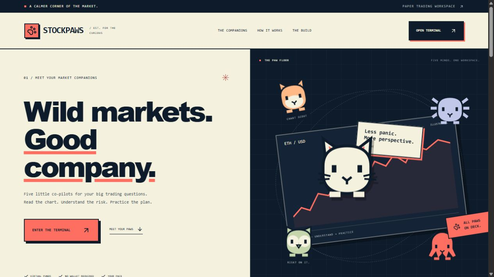
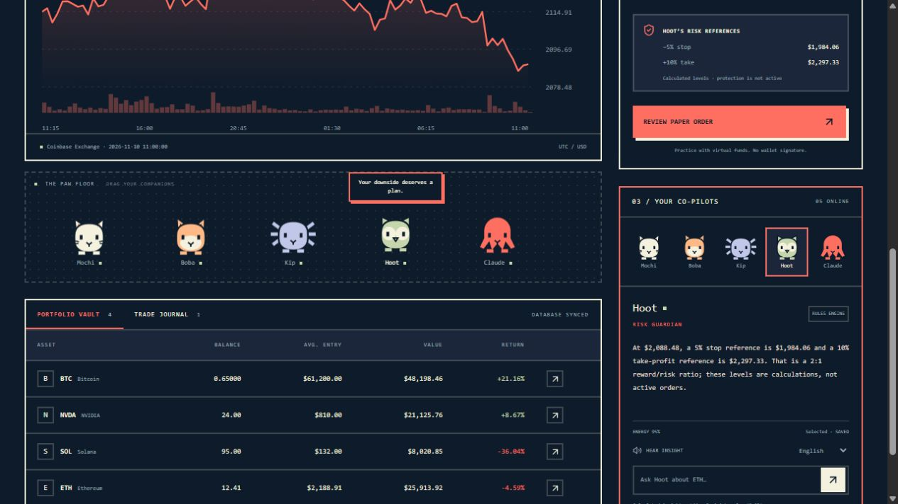
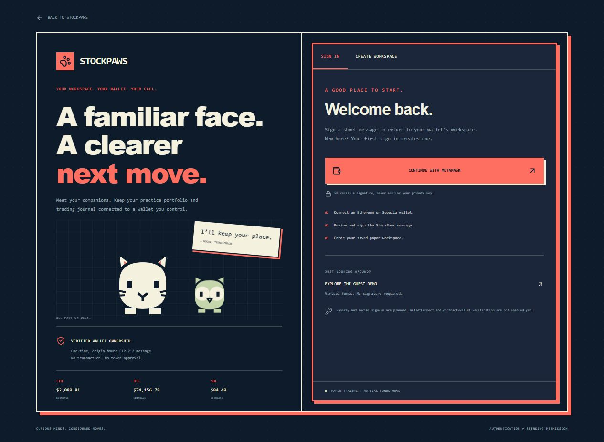
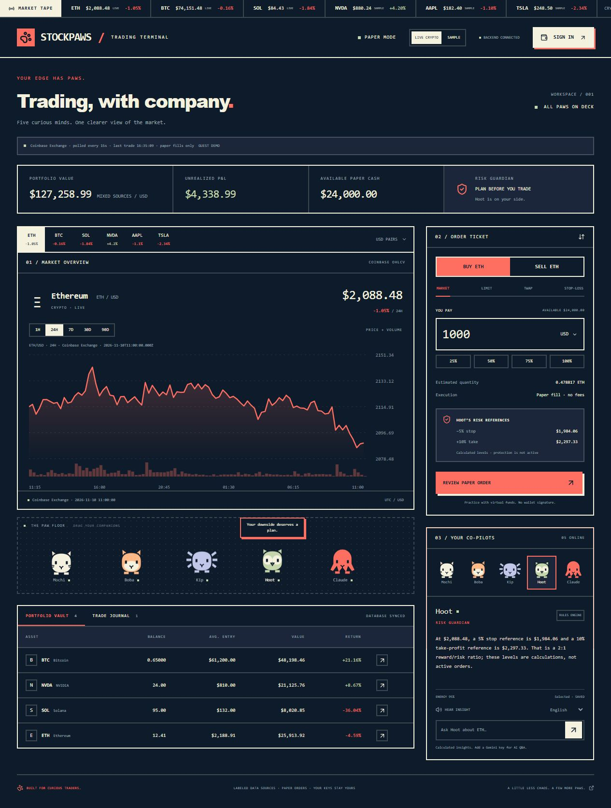
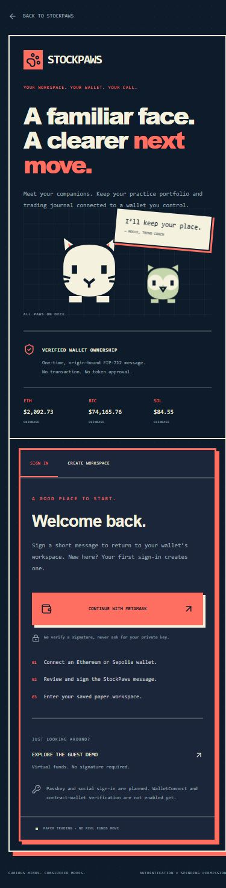
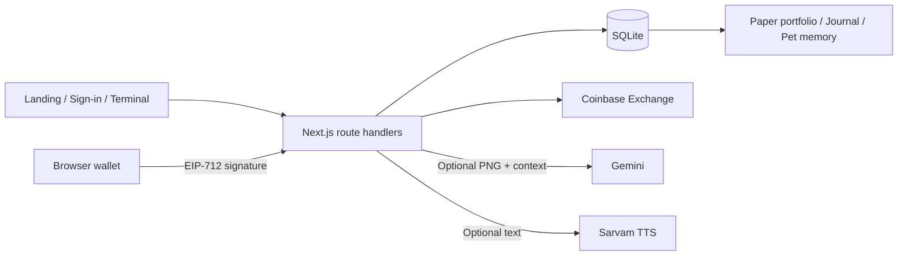

# StockPaws

**A market workspace with five pet co-pilots, wallet authentication, and persistent paper trading.**

StockPaws brings a calmer interaction model to trading tools. Explore a chart, ask a specialist companion a focused question, inspect the risk in dollars, and review a paper order before it changes your practice portfolio. The interface combines deep navy, warm cream, and coral with sharp borders, flat shadows, and animated vector mascots.



_The landing page introduces the companions and leads into wallet sign-in or the guest workspace._

[Features](#features) · [The companions](#the-companions) · [Screenshots](#screenshots) · [Run locally](#run-locally) · [Architecture](#architecture) · [Roadmap](#roadmap)

## Features

- **Wallet-linked workspaces.** MetaMask-compatible EIP-712 sign-in with expiring, one-time challenges, server-side signature verification, session rotation, and account recovery across browsers connected to the same backend.
- **Live crypto context.** Coinbase Exchange quotes and OHLCV history for ETH, BTC, and SOL, with source labels, exchange timestamps, polling, and explicit stale/unavailable states. Equities remain clearly labeled samples.
- **Persistent paper trading.** Server-priced market buys and sells, review screens, balance validation, weighted cost basis, transactional journal updates, and idempotent order submission.
- **Five interactive companions.** Select a specialist, drag the on-screen pets, inspect their activity, and persist their energy state.
- **Optional multimodal analysis.** Boba captures the actual SVG chart as a PNG. A server-side Gemini adapter accepts the image and requests validated JSON; numerical risk metrics remain server-calculated.
- **Optional voice playback.** A Sarvam adapter synthesizes the displayed analysis with English/Hindi voice selection.
- **Reviewable strategy drafts.** Limit, stop-loss, and TWAP plans are saved to the journal. They are not placed or scheduled.

**All trading uses virtual funds.** Live data does not imply live execution. The app does not send swaps, approve tokens, or transfer funds.

## The companions

Each pet has a distinct tool role. They share the same market context while presenting a different part of the decision.

| Companion            | Role              | What it does today                                                                                                                                                                                    |
| -------------------- | ----------------- | ----------------------------------------------------------------------------------------------------------------------------------------------------------------------------------------------------- |
| **Mochi — Cat**      | Trend coach       | Explains the selected asset’s 24-hour move in plain language. With Gemini configured, answers questions grounded in the server’s context; Sarvam can read the result aloud.                           |
| **Boba — Shiba**     | Chart scout       | Reports the observed chart range. Captures the rendered chart for optional Gemini vision analysis; clearly reports when image inference has not run.                                                  |
| **Kip — Axolotl**    | Quant analyst     | Converts the proposed dollar position into asset quantity and planned price risk. For example, a $1,000 position with a 5% stop reference has $50 planned price risk before fees, gaps, and slippage. |
| **Hoot — Owl**       | Risk guardian     | Calculates a stop reference 5% below entry and take-profit reference 10% above entry. These are reference levels, not active protective orders.                                                       |
| **Claude — Octopus** | Execution planner | Splits a proposed amount into four TWAP draft slices, 15 minutes apart. The schedule is a plan; no background execution runs.                                                                         |



_The pets live alongside the chart, order ticket, risk references, and portfolio. Activity and energy are stored on the server._

## Screenshots

### Wallet sign-in



The split-screen onboarding flow explains exactly what the signature proves. Wallet sign-in creates or resumes a paper workspace; the guest demo remains available without a signature. The left panel includes current crypto quotes and the companion artwork.

### Live terminal



The terminal combines live crypto history, labeled sample equities, a paper order ticket, the portfolio vault, and specialist analysis. History supports 1H, 24H, 7D, 30D, and 90D ranges. Live-price paper fills require a fresh server quote and must stay within 0.5% of the reviewed reference.

### Mobile onboarding



On smaller screens, onboarding stacks vertically. The terminal also adapts its chart, order ticket, and companion deck for mobile, with an accessible live/sample data switch.

Screenshots are actual captures of the locally running application. Displayed prices and practice balances are snapshots, not fixed product claims.

## Run locally

### Requirements

- **Node.js 24 or newer**, including the built-in `node:sqlite` module.
- npm.
- An Ethereum browser wallet for wallet sign-in. No wallet is required for the guest demo.

```bash
git clone https://github.com/Parths-29/Stock_agents.git
cd Stock_agents
npm ci
npm run dev
```

Open [http://127.0.0.1:3000](http://127.0.0.1:3000).

| Page                   | Path               |
| ---------------------- | ------------------ |
| Landing                | `/`                |
| Sign in                | `/login`           |
| Create a workspace     | `/signup`          |
| Authenticated terminal | `/terminal`        |
| Guest demo             | `/terminal?demo=1` |
| Health check           | `/api/health`      |

### Production mode

```bash
npm run build
npm run start -- --port 3012
```

Open [http://127.0.0.1:3012](http://127.0.0.1:3012). The default server binds to loopback for local use.

### Optional configuration

Copy `.env.example` to `.env.local` and add the integrations you want to enable. Restart the server after changing environment variables.

| Variable            | Purpose                                                                | Required?              |
| ------------------- | ---------------------------------------------------------------------- | ---------------------- |
| `GEMINI_API_KEY`    | Gemini text and chart-image analysis                                   | Only for Gemini        |
| `GEMINI_MODEL`      | Model available in your Google account; defaults to `gemini-2.5-flash` | No                     |
| `SARVAM_API_KEY`    | Sarvam text-to-speech playback                                         | Only for voice         |
| `STOCKPAWS_DB_PATH` | Persistent SQLite file; defaults to `data/stockpaws.sqlite`            | No                     |
| `APP_ORIGIN`        | Canonical browser origin when deployed behind a reverse proxy          | For that hosting setup |

API keys stay on the server. Without them, calculated insights, live crypto data, wallet sign-in, paper trading, and the journal still work. Gemini and Sarvam require valid credentials for provider-backed verification. Hindi voice selection does not automatically translate an English analysis.

## How it works

### Identity and persistence

1. A guest session receives a random HTTP-only cookie. The server stores a hash of the token.
2. Wallet sign-in issues a five-minute challenge bound to the origin, session, wallet, and Ethereum/Sepolia chain.
3. The wallet signs an EIP-712 ownership message. The server verifies it and consumes the challenge once.
4. A new authenticated session replaces the guest token. The first sign-in links the guest workspace; later sign-ins recover that wallet’s existing workspace.
5. Portfolios, order records, journals, pet activity, and quotas persist in SQLite.

Wallet sign-in currently supports externally owned Ethereum accounts. WalletConnect, contract-wallet verification, passkeys, and social login are not implemented.

### Market data and paper execution

- Crypto quotes use Coinbase’s ticker timestamp; quotes older than two minutes cannot fill live-price paper orders.
- History uses Coinbase OHLCV buckets, sorted and validated before rendering.
- Provider requests are cached and concurrent requests are coalesced. The client polls quotes every 15 seconds and the selected chart every 20 seconds.
- An unavailable crypto feed does **not** silently become a sample feed. Sample mode is an explicit user choice.
- Equity prices and their history are fixtures in both modes. Portfolio valuation therefore labels its mixed sources.
- Server-side fills ignore caller-supplied prices and balances. A database transaction saves the order, updated portfolio, and journal together.
- Request IDs make successful order retries safe. Paper fills omit trading fees, real liquidity, and market slippage.

### AI provenance

Gemini explanations are grounded in server-derived market context and deterministic risk calculations. Boba can attach a PNG of the displayed chart. The response includes provider/model labels, an application correlation ID, and whether image analysis actually occurred.

An application request ID is **not** TEE attestation. StockPaws currently makes no verified-enclave claim and generates no artificial transaction hashes or explorer links for paper trades.

## Architecture

| Layer            | Implementation                                                           |
| ---------------- | ------------------------------------------------------------------------ |
| Application      | Next.js App Router, React, TypeScript                                    |
| Interface        | Tailwind tokens, custom CSS, Lucide icons, native SVG charts and mascots |
| Wallet ownership | EIP-712 signatures verified with viem                                    |
| Market inputs    | Coinbase Exchange REST quotes and OHLCV                                  |
| Persistence      | Node.js SQLite with WAL, transactions, and session-scoped records        |
| Optional AI      | Gemini REST with PNG input and validated structured output               |
| Optional speech  | Sarvam REST text-to-speech                                               |
| Verification     | Node test runner through tsx, HTTP integration tests, browser QA         |



```text
app/
  login/ · signup/ · terminal/       Pages and onboarding
  api/auth/                          Challenge, verification, logout
  api/market/                        Quotes and OHLCV
  api/trade/                         Server-owned paper execution
  api/agent/ · api/voice/             Optional AI and speech
  api/session/ · api/portfolio/       Sessions and portfolio reads
  api/memory/ · api/health/           Journals, pets, readiness
components/                          Landing, auth, chart, terminal, pets
lib/server/                          Store, identity, providers, request guards
tests/                               Unit and HTTP integration checks
docs/screenshots/                    Actual application captures
data/                                Local database; ignored by Git
```

## Verification

```bash
npm test
npm run typecheck
npm run build
# Start the production server on port 3012, then:
npm run test:api
```

The suite covers wallet signatures and challenge replay, session isolation, quote freshness, malformed market data, deterministic risk, paper balance validation, idempotency, rollback, persistence, provider payloads, and origin checks. HTTP checks additionally exercise wallet account recovery and a live-price paper fill when the market provider is available.

See [VERIFICATION.md](VERIFICATION.md) for the current evidence and verification limits.

## Roadmap

| Area                                                    | Current status                                            |
| ------------------------------------------------------- | --------------------------------------------------------- |
| Landing, terminal, companions                           | Implemented                                               |
| Persistent paper backend and journal                    | Implemented                                               |
| EIP-712 wallet sign-in                                  | Implemented and tested with generated test accounts       |
| Live crypto quotes and OHLCV                            | Implemented and exercised against Coinbase                |
| Gemini text/vision and Sarvam TTS                       | Adapters implemented; API-key-backed verification pending |
| MongoDB cloud storage and voice input                   | Planned                                                   |
| Passkey/social/WalletConnect onboarding                 | Planned                                                   |
| Testnet swaps, gasless deposits, spend-policy contracts | Planned                                                   |
| TEE attestation and human-proof integrations            | Planned                                                   |
| Durable stop/limit/TWAP execution                       | Planned; current strategies are drafts                    |

See [PHASES.md](PHASES.md) for delivery boundaries and [PRODUCT_REVIEW.md](PRODUCT_REVIEW.md) for product reasoning.

The current backend targets a single Node server with persistent disk. Public hosting needs account/IP abuse controls, managed backups, and deployment-specific origin configuration; per-session quotas alone do not prevent guest-session replacement. Secrets, database contents, session tokens, and private wallet keys are excluded from the repository.
